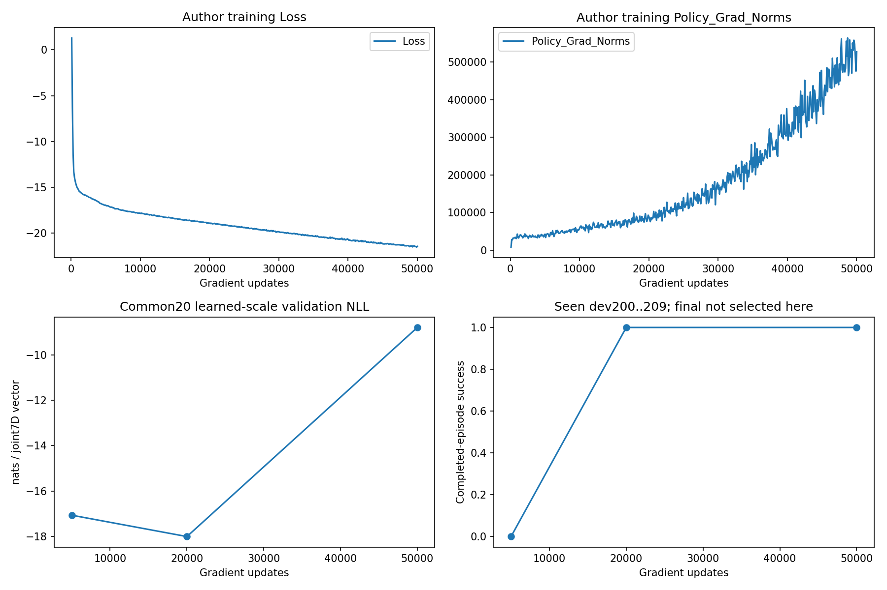

# 실험 결과 읽기

이 폴더에서 [observations.csv](observations.csv)는 다섯 실험의 집계값을, [robomimic-learning-curve.png](robomimic-learning-curve.png)는 프로젝트에서 기록한 학습·검증·행동 곡선을 담는다. 첫 번째 실험은 선박 조종 데이터를 바꿔 본 자체 비교다. 나머지 네 가지는 공개 벤치마크에서 평가 방법을 점검한 실행이다. 표마다 단위와 평가 대상이 다르다.

<a id="recovery"></a>

## 선박 조종 · 같은 학습기에 어떤 경험을 보여 줄까?

정상 주행을 모방한 모델이 경로에서 벗어났을 때도 돌아올 수 있을까? 학습 데이터 중 일부를 빗나간 상태에서 제자리로 복귀하는 시연으로 바꿨다. 총 18,000개 기록과 학습기, 학습 횟수, 세 학습 seed, 평가 출발점을 고정했다. 혼합 조건에서는 같은 장면의 기본·복구 시연 중 하나를 에피소드 단위로 골랐다.

| 학습 데이터 중 복구 시연 | 전체 | 정상 출발 | 복구 출발 |
|---|---:|---:|---:|
| 0% | 63.718 ± 0.286 | 64.742 | 62.695 |
| 50% | 64.813 ± 0.155 | 64.678 | 64.948 |
| 100% | 64.382 ± 0.409 | 64.155 | 64.608 |

자체 평가 점수는 높을수록 좋다. 전체 열은 학습 seed 세 개의 평균 ± 표본 표준편차다. 각 seed마다 정상 출발 12개와 복구 출발 12개를 썼다. 혼합 정책은 복구 출발 점수가 올랐고, 정상 출발 점수는 기본 데이터만 쓴 경우와 비슷했다. 기본·복구 단독 결과는 앞선 동일 조건 실행에서 가져왔고, 혼합 조건만 새로 학습했다. 같은 평가 장면을 다시 사용했으므로 다른 환경에서의 최적 비율은 이 표로 정할 수 없다.

<a id="barn"></a>

## BARN · 주행 시간을 비교할 때

장애물 사이를 달리는 공개 지상로봇 벤치마크에서 DWA와 E-Band를 같은 지도와 초기 조건으로 실행했다. 두 방법 모두 완주했다. 시뮬레이션 시간은 각각 31.324초와 24.159초, 저자 평가 코드가 낸 점수는 0.2170과 0.2813이었다. 같은 코스에서 두 정책의 결과를 끝까지 회수한 **한 쌍의 비교**다. 다른 지도에서의 순위는 이 실행으로 알 수 없다. [BARN 데이터와 벤치마크](https://www.cs.utexas.edu/~xiao/BARN/BARN.html)

## RLC · 보지 않은 입력에서 동역학을 예측할 때

공개 RLC 전기회로 기록으로 동역학 추정 절차를 점검했다. 20,000회 업데이트 후 독립 테스트 기록에서 전압 R²는 0.993150, 전류 R²는 0.971059였다. RMSE는 전압 6.529 V, 전류 0.807 A였다. 전기회로를 쓴 이유는 관측과 예측을 시간에 맞춰 비교할 독립적인 공개 입력이 있기 때문이다. 이 측정은 회로의 예측 성능에 해당한다. [저자 코드와 데이터](https://github.com/forgi86/sysid-neural-continuous)

## robomimic Lift

로봇 팔이 물체를 드는 공개 과제에서 180개 시연으로 BC-RNN/GMM 모방학습 정책을 학습했다. 개발 출발점 10개에서 성공은 5,000회 업데이트 때 0/10, 20,000회와 50,000회 때 각각 10/10이었다. 아래 그림의 왼쪽 아래에서 검증 음의 로그우도(NLL)는 마지막 구간에 다시 커지지만, 오른쪽 아래에서 성공률은 같은 구간 내내 1.0이다. 두 값이 서로 다른 질문에 답한다는 사례다.



그림은 이 프로젝트에서 원저자 코드로 학습한 한 번의 실행을 보여 준다. 오른쪽 아래는 이미 본 개발 출발점 10개의 성공률이다.

최종 평가는 위 개발 출발점과 분리한 50개 초기 상태에서 했다. 50,000회 학습한 모델은 50/50, 저자가 배포한 체크포인트는 47/50 성공했다. 두 모델이 함께 성공한 경우가 47개, 학습 모델만 성공한 경우가 3개였다. 학습 seed 하나의 결과이고 두 체크포인트의 학습 이력도 다르다. [평가 함수](../autonomy_lab/behavior_evaluation.py) · [robomimic 연구와 공개 자료](https://robomimic.github.io/study/)

<a id="planet"></a>

## PlaNet · 예측 모델로 행동을 고를 때

공개 Cartpole Swingup에서 같은 다섯 초기 상태로 무작위 행동과 CEM 계획을 비교했다. CEM은 모델 안에서 여러 행동열의 보상을 예측해 유망한 행동을 고른다. 에피소드 평균 보상은 무작위 133.15, CEM 142.60이었다. 그러나 CEM이 앞선 쌍은 2/5이고, 쌍별 보상 차이의 중앙값은 −2.53이었다. 평균 하나만 보고 제어가 일관되게 나아졌다고 판단하기에는 표본이 작다. [PlaNet 논문](https://proceedings.mlr.press/v97/hafner19a.html) · [저자 코드](https://github.com/google-research/planet)

## 표의 수치를 직접 확인하기

`observations.csv`에서 `study`는 실험, `condition`은 비교 조건, `metric`은 지표다. `value`는 관측값, `unit`은 단위, `scope`는 분모나 평가 범위를 나타낸다. 예를 들어 `final_successes = 47`은 `scope`에 표시된 50개 출발점 중 47회 성공했다는 뜻이다.

```sh
python examples/read_results.py robomimic --metric final_successes
```
